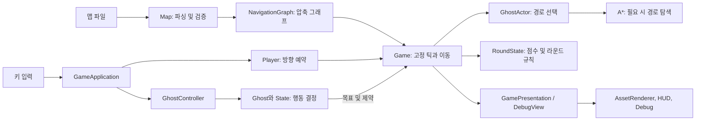
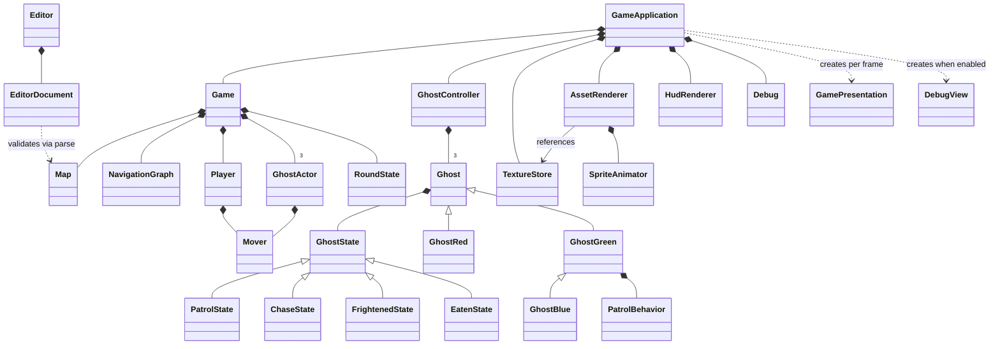
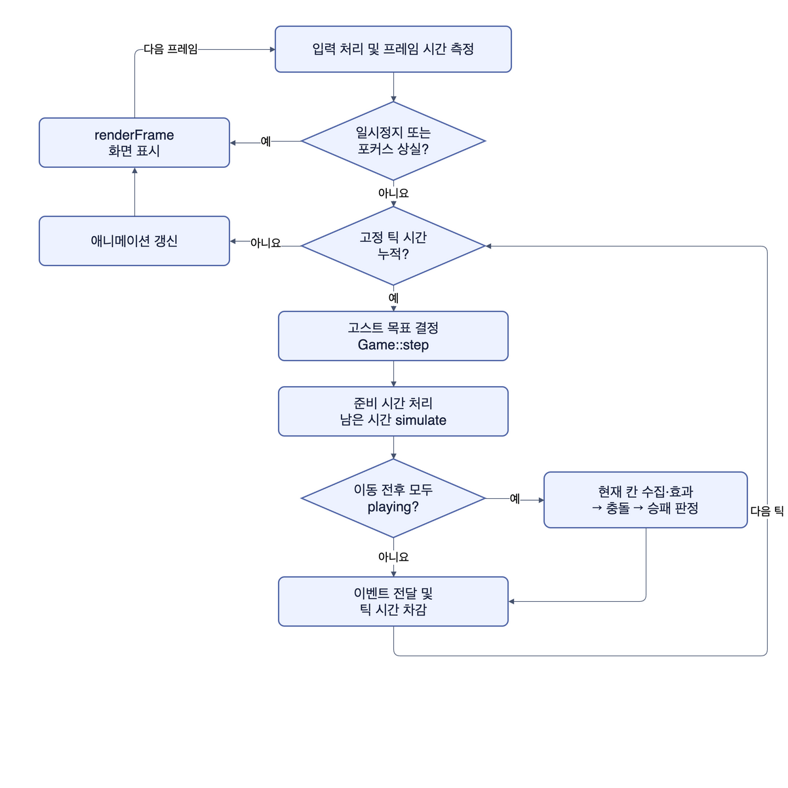
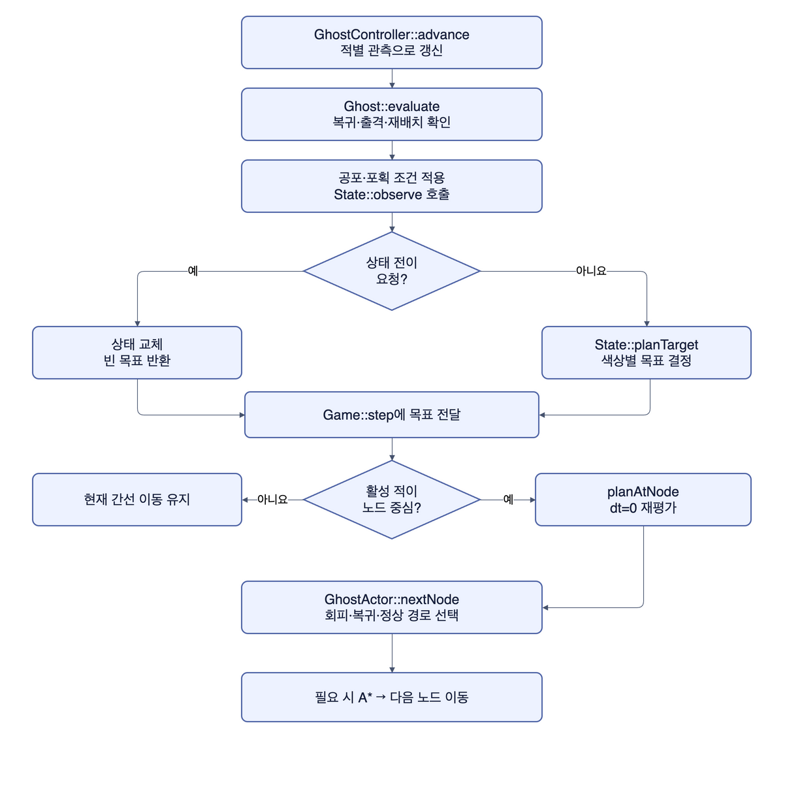
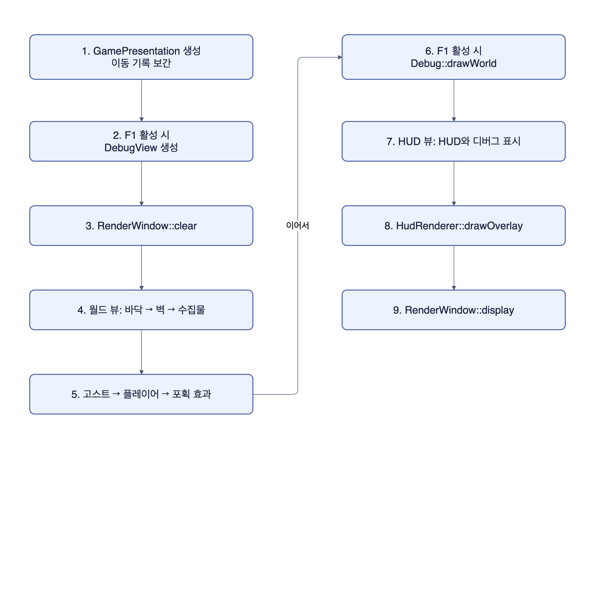
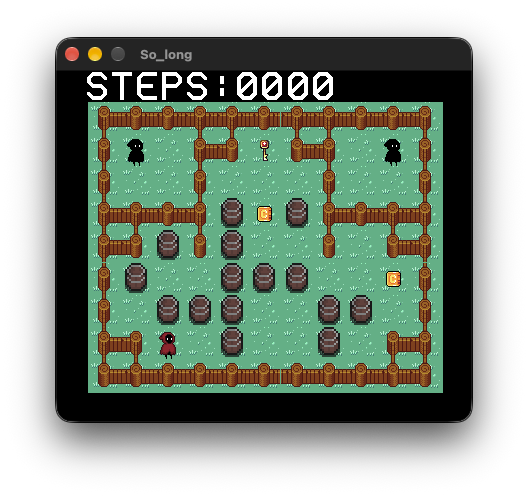
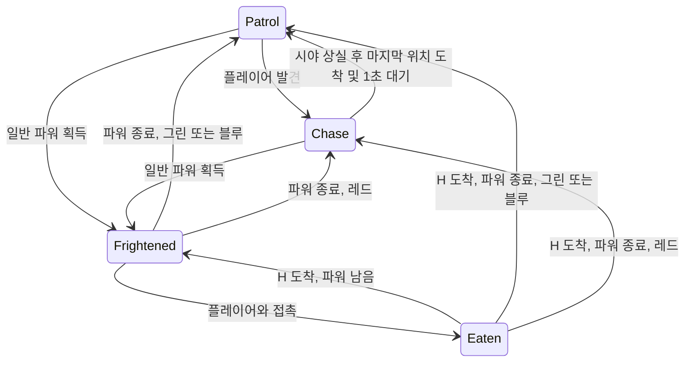

# 팩맨 프로젝트 보고서
202313154 이준서

## 1. 프로젝트 개요

### 1.1 개발 목적과 과제 목표


원작 팩맨의 고스트들이 움직이는 규칙에 대해서 정확하게 알고 있지 못하기 때문에, 그냥 그것들을 찾아보고 원작에 충실하게 구현하기보다 내가 생각하기에 재미 있을 것 같은 3가지의 몬스터를 설계했습니다.

레드는 항상 플레이어를 추격하고, 그린은 무작위로 맵을 탐색하다, 플레이어를 발견하고 쫓아오며, 블루는 플레이어 주변의  파워 아이템을 지키도록 설계해서 레드로부터 도망치는 것을 힘들게 만들었습니다. 공통 동작에는 State 패턴을, 목표 지점까지의 이동에는 A* 알고리즘을 사용했습니다.

게임 내의 AI / 이동등의 동작을 그리드 기반으로 다루기에는 제한 사항이 생길 것 같아서 그리드 형태로 구성된 맵 파일을 읽어 와 가능한 경로들을 노드로 구분한 다음, 그 노드 그래프를 통해서 게임 시스템이 동작하도록 구성했습니다. 또한, A* 계산을 매 프레임이 아닌, 노드에 도달했을 시에만 계산을 진행하도록 하여서 연산량을 줄였습니다.

게임 스프라이트에 에니메이션을 넣을 수 있도록 SpriteAnimator 를 만들어서 게임 에니메이션을 쉽게 렌더링 할 수 있도록 구성하였으며, 케릭터의 이동을 노드의 끝에 도착하기 전, 미리 방향키로 다음 경로를 정해놓을 수 있도록 해서 편한 조작이 가능하도록 하였습니다.

그리고 원작에 먹으면 고스트 잡아먹을 수 있게 되는 파워 이외에 또 재미난 기믹을 추가해 보려고 하였고 먹었을 때 적들의 위치를 렌덤하게 설정하는 꽃 아이템을 하나 추가 하였습니다.

### 1.2 개발 환경과 도구

macOS에서 C++20과 SFML 2.6.2를 사용해 개발하였고, clang++과 Makefile로 빌드하며, clang-format과 clangd로 코드 형식과 편집 환경을 관리했습니다.

최종 과제를 제출하기 위해서 윈도우용으로 빌드를 뽑을 때에는, MinGW-w64 개발환경으로 세팅 후 UCRT64 clnag++을 이용하여 빌드하였습니다.

코드 에디터는 VSCode 를 사용하였으며, clang-format 파일을 만들어서 코드 서식을 통일화 했습니다. CPP LSP 는 Clangd 를 사용했습니다.

## 2. 게임 구조와 기본 메커니즘

### 2.1 주요 클래스의 역할

|구성 요소 |역할 |
| --- | --- |
|`Map`, `MapLoader` |맵 파일을 읽고 지형, 수집물, 하우스와 연결성을 검증한다. |
|`NavigationGraph`, `findPath` |이동 가능한 지형으로 압축 그래프를 만들고 A* 경로를 계산한다. |
|`Mover`, `Player` |연속 좌표 이동과 플레이어의 방향 예약을 처리한다. |
|`Game`, `RoundState`, `GhostActor` |고정 업데이트, 충돌, 점수와 효과, 고스트의 이동 경로를 관리한다. |
|`Ghost`, `GhostState`, `GhostController` |색상별 행동과 네 가지 상태를 결정해 이동 목표를 전달한다. |
|`GamePresentation`, `AssetRenderer`, `HudRenderer`, `Debug` |게임 상태를 표시용 자료로 변환하고 월드, HUD, 디버그 정보를 그린다. |


#### 게임과 AI의 연결

`GameApplication`이 입력과 프레임 루프를 조정합니다. `Game`은 맵, 플레이어와 세 고스트의 실제 이동 데이터를 소유합니다. `GhostController`는 각 고스트의 행동 상태를 갱신하고 이동 목표를 `Game`에 전달합니다. `GhostActor`는 그 목표와 공통 효과를 바탕으로 경로를 정합니다. 렌더러는 게임 상태에서 만든 표시 자료를 읽습니다.



#### 주요 클래스 구조도

다음 UML은 주요 소유 관계와 상속 관계를 나타냅니다. `Ghost`는 행동을 결정하고, `GhostActor`는 실제 이동과 경로를 관리합니다. `findPath`는 독립 함수이므로 클래스 구조도에 포함하지 않았습니다.



#### 게임 플레이 실행 흐름

`GameApplication`은 입력을 처리하고, 프레임 시간을 누적해 1/60초마다 고정 업데이트를 실행합니다. 한 프레임에서 고정 업데이트가 여러 번 실행될 수 있습니다.



창 종료 이벤트가 발생하면 프레임 루프를 끝냅니다. `Game::step`이 이미 종료 상태를 만나면 이동 대신 정지 기록을 남깁니다. 수집 중 오류가 발생하면 그 틱의 충돌과 승패 판정을 건너뜁니다.

`simulate`는 노드 도착, 고스트 출격, 파워 만료 시점에 맞춰 이동 시간을 나눕니다. 활성 고스트가 노드에 도착하면 목표를 다시 계산합니다. 사망 복귀 중에는 플레이어가 정지하고 고스트가 H로 돌아갑니다. 복귀가 끝난 틱에는 즉시 재충돌하지 않습니다.

#### 적 AI 실행 흐름

고정 업데이트에서 각 고스트의 상태와 목표를 평가합니다. 고스트가 노드 중심에 도착하면 `dt=0`으로 다시 계획하므로 타이머를 중복해서 진행하지 않습니다. 공포 회피와 하우스 복귀는 정상 목표보다 우선합니다.



#### 게임 렌더링 흐름

`GamePresentation`은 이동 기록을 보간해 표시 위치를 만듭니다. `AssetRenderer`는 바닥, 벽, 수집물과 배우를 그리고, 이후 디버그 정보와 HUD를 표시합니다. 포획 이벤트는 앞선 고정 업데이트에서 전달받습니다.



### 2.2 게임 루프와 렌더링

게임을 처음 제작하기 시작했을 때 들었던 생각은, 지금까지 실습에서는 SFML 내부 기능만 사용했는데 외부 이미지 파일은 어떤 식으로 렌더링하지? 그리고 애니메이션은 어떻게 처리하지? 였는데, 42SEOUL에서 이전에 제작했었던 so_long 이라는 과제를 참고해서, 렌더 구조와 애니메이션 처리를 구상했습니다.



일단 바닥과 벽은 게임을 진행하는 도중에 변하지 않기 때문에. 그 전체 맵에 대한 바닥 텍스처와 벽 텍스처를 게임을 시작했을 때 미리 계산해 두고 재사용하는 식으로 구조를 작성했습니다.

배경(바닥)과 벽을 렌더링 한 후에는 그 위에 수집물, 고스트, 플레이어, 포획 효과와 HUD를 순서대로 그립니다.

`GameApplication`은 입력을 읽고 누적된 프레임 시간에 따라 1/60초 단위로 게임을 갱합니다. 유니티의 detatime 처럼 실제 프레임과 고정 업데이트 사이에는 보간 위치를 사용해 움직임을 그리도록 구성했습니다.

렌더링은 프레임당 `clear`와 `display`를 한 번씩 호출하며, 일시정지 중이거나 창의 포커스를 잃으면 게임 진행을 멈추도록 구현했습니다.

### 2.3 타일 맵과 벽 충돌

맵 파일은 한 줄에 48문자, 32줄로 구성된 텍스트 파일입니다. `#`은 벽, 공백과 `.`은 길, `o`는 일반 파워, `s`는 위상 교란(위치 변경 파워), `P`는 플레이어 시작점, `H`는 고스트 하우스 입니다. 점수를 주는 펠릿은 길에 자동으로 생성되도록 하였습니다.

파일을 게임에 불러올 때, 크기와 문자, P와 H의 개수, 하우스 모양, 모든 길(벽이 아닌) 타일들이 연결되어 있는지 검사며, 플레이어가 H를 통과하지 않고도 모든 수집물에 도달할 수 있는지도 검사합니다.

같은 행의 좌우 끝이나 같은 열의 상하 끝이 모두 길이면 두 끝이 연결되도록 해서, 펙멘 게임들에 존재하는 터널을 구현했습니다. (제 기억 속 게임을 회상하면서 제작한 것이라서 원작에 있었는지는 잘 모르겠습니다.) 한쪽만 열려 있으면 통과할 수 없고, 경계의 비용은 한 타일이며 플레이어와 고스트 모두 이용할 수 있도록 하였습니다.

### 2.4 플레이어 이동과 수집

개발 목적과 과제 목표에서 설명했듯이, 방향키를 미리 입력하면 다음 노드 중심에서 그 방향을 적용하도록 구현했습니다. 이는 교차점에 캐릭터가 멈추거나, 정확한 순간 키를 눌러야만 방향을 바꿀수 있는 불편함을 개선하기 위해서 추가한 기능입니다. 또한 노드 진행 중 반대 방향의 키를 눌러 뒤돌아 갈 수 있도록 했습니다.

교차 노드에 도착했지만, 입력한 방향이 막혀 있으면 멈추도록 했습니다. 그냥 자동으로 가능한 경로로 진행할 수 있도록 할까 고민을 했지만, 과제의 요구사항과 좀더 비슷하게 만들기 위해서 멈추도록 설계했습니다.

또한 파워 획득과 고스트의 접촉이 같은 시각에 이루어지면, 파워 획득을 우선으로 처리하도록 되어 있습니다.

### 2.5 점수, 목숨과 게임 종료

PacMan/Scripts/System/GameConfig.h 에서 대부분의 수치를 설정할 수 있으며, 기본적으로

일반 펠릿은 100점, 위상 교란은 500점, 일반 파워는 1000점, 공포 상태 고스트 포획은 2000점 입니다.

초기 목숨은 3개이며, 고스트와의 거리가 20px 이하면 접촉으로 판정합니다. 맵 양 끝에 있는 통로에서도 마찬가지의 판정을 가집니다.

사망하면 점수와 수집 상태를 유지한 상태로 플레이어는 사망 위치에서 점멸하며 기다리고, 세 고스트가 H에 돌아온 뒤 같은 위치에서 재개합니다. 목숨이 0이면 패배하고 수집물을 다 모으면 승리합니다.

## 3. FSM 기반 고스트 AI

### 3.1 State 패턴과 전이

`Ghost`는 현재 `GhostState`를 소유하고 `PatrolState`, `ChaseState`, `FrightenedState`, `EatenState`가 각 상태의 행동을 담당한다. 상태의 판단 함수가 반환된 후 전이를 적용해, 실행 중인 상태 객체가 도중에 삭제되지 않게 했다. 색상별 목표 선택은 `GhostRed`, `GhostGreen`, `GhostBlue`가 구현한다.



레드 고스트는 공포가 아닌 이사 항상 플레이어를 쫓아갑니다. 다만 속도가 플레이어보다 조금 느리기 때문에 조작을 잘 하면, 도망치기 쉽습니다.
블루 고스트는 일반 파워가 2개 이상이면 플레이어에게 가까운 최대 3개를 후보로 삼고, 아직 방문하지 않은 파워를 차례로 순찰합니다. 파워가 1개 이하이면 무작위 순찰합니다.
그린 고스트는 렌덤하게 맵을 돌아다닙니다.

블루와 그린 의 추적 상태로의 전이조건은 다음과 같습니다.

- 플레이어가 고스트의 상하좌우 **16칸, 이내**.
- 바라보는 방향과 수직인 축의 위치 차이가 **4px 이하**.
- 고스트와 플레이어 사이에 벽이 없습니다.

이 조건을 만족하면 순찰 상태에서 추적 상태로 전환합니다.

**추적 유지 조건**은 다음과 같습니다.

1. 플레이어가 계속 보이면 추적을 유지하고 마지막으로 본 위치를 갱신.
2. 플레이어가 시야에서 사라져도 마지막으로 관측한 탐색 노드까지 이동.
3. 그 노드에 도착한 뒤 **1초 동안** 대기,  그동안 다시 발견하지 못할 시 순찰.
4. 이동 중이나 대기 중 플레이어를 다시 발견하면 즉시 추적.

추적 **방식**에는 차이가 있습니다.

- **그린:** 플레이어가 향하는 다음 교차점에 먼저 도착할 수 있으면 차단. 차단이 어렵다면 직접 추격.
- **블루:** 일반 파워가 2개 이상 남으면 직접 추격. 1개 이하이면 그린처럼 교차점 차단을 시도.


#### 상태 전이 적용 코드

[`Ghost::evaluate`](Scripts/AI/Ghost.cpp)는 사망 복귀, 출격, 재배치와 공포·포획 조건을 확인한 다음 현재 상태의 `observe`를 호출합니다. 상태가 전이를 반환하면 `observe`가 끝난 뒤 `applyState`를 호출합니다. 상태가 실행 중일 때 그 상태 객체가 교체되지 않도록 하기 위한 순서입니다.

```cpp
GhostTarget Ghost::evaluate(const AiContext& context, double dt)
	{
		const auto& actor = context.actor;
		if (context.phase == RoundPhase::recovering) {
			if (!mRecovering) {
				resetNormalMemory();
				applyState({mInitialState, {}});
			}
			mRecovering = true;
			return {};
		}
		mRecovering = false;
		if (!context.released)
			return {};
		if (mLastRelocation != actor.relocation) {
			resetNormalMemory();
			mLastRelocation = actor.relocation;
		}
		recordMovement(context);
		const auto old = mState->kind();
		const auto desired = actor.condition == GhostCondition::eaten							   ? GhostStateKind::eaten
							 : actor.condition == GhostCondition::frightened					   ? GhostStateKind::frightened
							 : (old == GhostStateKind::eaten || old == GhostStateKind::frightened) ? (mInitialState)
																								   : old;
		if (desired != old) {
			if (desired == GhostStateKind::patrol || desired == GhostStateKind::chase)
				resetNormalMemory();
			// No old-state decision is made when a higher-priority common condition has changed.
			applyState({desired, {}});
		}
		const auto transition = mState->observe(*this, context, dt);
		// Deferred application: the currently executing State has returned before it is destroyed.
		if (transition) {
			applyState(*transition);
			return {};
		}
		return mState->planTarget(*this, context);
	}
```

#### 순찰에서 추격으로 전환하는 코드

[`PatrolState::observe`](Scripts/AI/GhostState.cpp)는 플레이어를 발견하면 관측 노드를 전이 자료로 넘깁니다. 레드의 `mAlwaysChase`는 시야와 관계없이 Chase를 선택합니다.

```cpp
std::optional<StateTransition> PatrolState::observe(Ghost& ghost, const AiContext& context, double dt)
	{
		if (ghost.mAlwaysChase)
			return StateTransition{GhostStateKind::chase, {}};
		if (visible(context))
			return StateTransition{GhostStateKind::chase, context.player.mover().planningNode()};
		ghost.advancePatrol(context, dt);
		return {};
	}
```

#### 추격을 유지하고 종료하는 코드

[`ChaseState::observe`](Scripts/AI/GhostState.cpp)는 플레이어가 보이면 마지막 관측 노드를 갱신하고 대기 시간을 지웁니다. 놓치면 마지막 노드까지 이동하며, 노드에 도착해 1초를 기다린 뒤 Patrol로 전환합니다. 관측 기억이 없으면 바로 Patrol로 돌아갑니다.

```cpp
std::optional<StateTransition> ChaseState::observe(Ghost& ghost, const AiContext& context, double dt)
	{
		if (ghost.mAlwaysChase) {
			ghost.advanceChase(context, dt);
			return {};
		}
		if (!visible(context)) {
			mSearch.searching = true;
			ghost.onSightLost();
			if (!mSearch.lastSeenNode)
				return StateTransition{GhostStateKind::patrol, {}};
			if (context.actor.mover.centerNode() == mSearch.lastSeenNode) {
				mSearch.waitElapsed += dt;
				if (mSearch.waitElapsed + 1e-10 >= GameConfig::searchWaitSeconds)
					return StateTransition{GhostStateKind::patrol, {}};
			}
			return {};
		}
		mSearch.lastSeenNode = context.player.mover().planningNode();
		mSearch.waitElapsed = 0;
		mSearch.searching = false;
		ghost.advanceChase(context, dt);
		return {};
	}
```

시야 검사는 [`Ghost::canSeePosition`](Scripts/AI/Ghost.cpp)에서 공통으로 수행합니다. `sightPixels`는 512px, 축 오차는 4px입니다. 위치 사이를 최대 8px 간격으로 검사해 벽을 확인합니다. 좌표 차이에는 순환 거리를 사용합니다.

```cpp
bool Ghost::canSeePosition(const Map& map, WorldPosition b, WorldPosition a)
	{
		const auto delta = wrappedDelta(b, a);
		const double dx = std::abs(delta.x), dy = std::abs(delta.y);
		if (!((dx <= GameConfig::sightAxisTolerance && dy <= GameConfig::sightPixels) ||
			  (dy <= GameConfig::sightAxisTolerance && dx <= GameConfig::sightPixels)))
			return false;
		const int steps = std::max(1, static_cast<int>(std::ceil(std::hypot(dx, dy) / 8)));
		for (int i = 1; i < steps; ++i) {
			const double f = static_cast<double>(i) / steps;
			const auto sample = wrapPosition({b.x + delta.x * f, b.y + delta.y * f});
			TilePos tile{static_cast<int>(sample.x / Map::tileSize), static_cast<int>(sample.y / Map::tileSize)};
			if (!map.isWalkable(tile))
				return false;
		}
		return true;
	}
```

블루는 남은 일반 파워 수에 따라 추격 목표를 선택합니다. 아래 코드는 [`GhostBlue::chaseVisible`](Scripts/AI/GhostBlue.cpp)의 실제 구현입니다. 그린은 예측 교차점에 먼저 도착할 수 있으면 차단하고, 그렇지 않으면 직접 추격합니다.

```cpp
GhostTarget GhostBlue::chaseVisible(const AiContext& context)
	{
		if (context.map.remainingPowerPellets() <= 1)
			return GhostGreen::chaseVisible(context);
		return {chaseAttachment(context), {}, {}};
	}
```

### 3.2 Frightened와 Eaten

일반 파워를 수집하면 포획 중인 고스트를 제외한 고스트가 8초 동안 Frightened가 되어, 정상 속도의 60%로 도망합니다. 다음 노드를 고를 때 플레이어와의 거리가 더 먼 노드를 선택하며, 각 고스트의 원래 색보다 밝게 표시됩니다. 파워를 다시 얻으면 남은 시간이 8초로 갱신됩니다.

공포 상태의 고스트에 접촉하면 Eaten으로 상태가 바뀌고 A* 로 H으로 복귀합니다. 복귀중에는 접촉 피해나 재포획이 발생하지 않습니다. H에 도착했을 때 파워가 남아 있으면 다시 공포 상태가 되고, 파워가 끝났으면 색상별 정상 행동으로 복귀합니다.

위상 교란은 공포를 부여하지 않으며, 기존 공포 시간과 상태를 유지하면서 고스트를 서로 다른 안전 노드로 재배치 합니다. 플레이어로부터의 거리와 H, 출구, 시작점 등을 고려해 후보를 고르고, 위치 이동 후에는 이전 경로와 행동 기억을 정리합니다.


[`FrightenedState::chooseNext`](Scripts/AI/GhostState.cpp)는 이웃 노드를 비교해 플레이어와의 거리 내림값이 가장 큰 노드를 고릅니다. 같은 거리라면 먼저 살펴본 이웃을 유지합니다.

```cpp
std::optional<NodeId> FrightenedState::chooseNext(const NavigationGraph& graph, const Mover& player, NodeId current)
	{
		std::optional<NodeId> best;
		int bestDistance = 0;
		for (auto neighbor : graph.at(current).neighbors) {
			const int distance = player.flooredDistanceToNode(graph, neighbor);
			if (!best || distance > bestDistance) {
				best = neighbor;
				bestDistance = distance;
			}
		}
		return best;
	}
```

[`GhostActor::nextNode`](Scripts/System/GhostActor.cpp)는 사망 복귀 또는 Eaten 조건을 공포 회피보다 우선합니다. 복귀할 때는 H를 목표로 경로를 계획하고, 공포 상태에서는 위 회피 함수를 사용합니다.

```cpp
std::optional<NodeId> GhostActor::nextNode(const Map& map, const NavigationGraph& graph, const Mover& player,
											   bool returning, NodeId current, const GhostTarget& requested)
	{
		returning = returning || condition == GhostCondition::eaten;
		if (!returning && condition == GhostCondition::frightened)
			return FrightenedState::chooseNext(graph, player, current);
		if (returning)
			planPath(graph, current, EatenState::homeTarget(map, graph));
		else
			planPath(graph, current, requested);
		const auto at = std::find(path.begin(), path.end(), current);
		if (at == path.end() || at + 1 == path.end())
			return {};
		return *(at + 1);
	}
```

## 4. A* 길찾기 설계

### 4.1 압축 그래프와 이동 비용

`NavigationGraph`는 교차점, 모퉁이, 막다른 길과 P, H, 출구, 경계 루프의 필수 지점을 노드로 만들어 관리하도록 하였고, 직선 통로 중간 타일은 하나의 간선으로 압축하고, 간선 비용에는 압축된 타일 수를 기록해서 경로 비용 계산이 그리드일때와 같도록 설계 하였습니다.

[`NavigationGraph::build`](Scripts/AI/NavigationGraph.cpp)의 다음 부분은 직선 통로 중간을 제외하고 필요한 타일만 노드로 남깁니다. 이후 `connectCorridor`가 노드 사이를 연결합니다.

```cpp
		const TilePos here{x, y};
		const auto neighbors = walkableDirections(map, here);
		const bool straight = neighbors.size() == 2 && neighbors[0].x + neighbors[1].x == 0 && neighbors[0].y + neighbors[1].y == 0;
		const bool wrapAnchor = ((x <= 1 || x >= Map::width - 2) && map.step({0, y}, {-1, 0})) ||
								((y <= 1 || y >= Map::height - 2) && map.step({x, 0}, {0, -1}));
		const bool anchor = here == map.playerSpawn() || here == map.house() || here == map.houseExit() || wrapAnchor;
		if (straight && !anchor)
			continue;
```

### 4.2 Open List와 휴리스틱

`findPath`는 시작 노드에서 현재 노드까지의 비용 `g(n)`과 목표까지의 추정 비용 `h(n)`을 더한 `f(n) = g(n) + h(n)`으로 탐색 순서를 정하며, Open List는 `priority_queue`로 구현해 f가 작은 노드를 먼저 꺼내도록 하였습니다. Closed 배열은 처리한 노드를 기록한며, 이웃을 방문할 때 실제 간선 비용을 더한 경로가 기존 비용보다 작으면 비용과 부모 노드를 갱신해 큐에 넣도록 하였습니다.

휴리스틱은 가로와 세로의 순환 맨해튼 거리이며, 각 축에서 직접 거리와 맵 반대편을 통한 거리 중 작은 값을 더합니다. 벽이나 닫힌 경계를 무시한 추정값이므로 실제 경로보다 길어지지 않으며, 목표에 도달하면 부모를 따라 시작점까지 역추적하고 순서를 뒤집어 경로를 반환합니다.

[`findPath`](Scripts/AI/AStar.cpp)의 휴리스틱은 각 축에서 직접 거리와 경계 너머 거리 중 작은 값을 사용합니다.

```cpp
const auto heuristic = [&](NodeId id) {
	const auto a = graph.at(id).tile;
	const auto b = graph.at(goal).tile;
	const int dx = std::abs(a.x - b.x), dy = std::abs(a.y - b.y);
	return std::min(dx, Map::width - dx) + std::min(dy, Map::height - dy);
};
```

다음 탐색 루프는 우선순위 큐에서 노드를 꺼내고, 더 짧은 경로를 찾으면 비용과 부모를 갱신합니다. 목표에 도달하면 부모를 따라 경로를 복원합니다. 허용 영역과 금지 간선도 이웃을 검사할 때 적용합니다.

```cpp
while (!open.empty()) {
	const auto current = open.top().node;
	open.pop();
	if (closed[current.value])
		continue;
	closed[current.value] = true;
	if (current == goal) {
		std::vector<NodeId> path{goal};
		while (path.back() != start)
			path.push_back(parent[path.back().value].value());
		std::reverse(path.begin(), path.end());
		return path;
	}
	for (auto next : graph.at(current).neighbors) {
		if ((!allowed.empty() && !allowed[next.value]) ||
			(blockedEdge && ((current == blockedEdge->first && next == blockedEdge->second) ||
							 (current == blockedEdge->second && next == blockedEdge->first))) ||
			!graph.canEnter(next, traveler) || closed[next.value])
			continue;
		const int candidate = cost[current.value] + graph.edgeCost(current, next);
		if (candidate < cost[next.value]) {
			cost[next.value] = candidate;
			parent[next.value] = current;
			open.push({candidate + heuristic(next), next});
		}
	}
}
```

반환 경로는 시작과 목표를 모두 포함하며 도달할 수 없으면 `nullopt`를 반환합니다.

### 4.3 적용과 재계산

레드의 추격과 모든 고스트의 Eaten 복귀에 A* 를 사용합니다. 그린의 차단 가능성 및 블루의 경비 경로 판단에도 경로와 거리를 이용하며, 공포 상태 회피는 A* 목적지 대신 이웃 노드를 비교합니다.

고스트의 경로 계획은 탐색 노드 중심에 도착 시 계산하며, 간선 중간에 목표나 상태가 바뀌면 바로 반영하는 것이 아닌 다음 노드에서 반영합니다.목표, 허용 영역, 금지 간선이 같고 현재 노드가 기존 경로에 있으면 경로를 재사용 합니다. 따라서 매 프레임이나 일정 주기로 전체 경로를 다시 계산하지 않기에, 연산량을 아낄 수 있습니다. 그린의 차단 후보 평가는 시간 조건도 사용하지만 실제 경로 검사는 노드 중심에서 수행합니다.


[`GhostActor::planPath`](Scripts/System/GhostActor.cpp)는 목표와 제약이 같고 현재 노드가 기존 경로에 있으면 탐색을 생략합니다. 조건이 바뀌면 경로를 지우고 `findPath`를 호출합니다.

```cpp
const auto nextTarget = requested.node;
const auto& nextAllowed = requested.allowed;
const auto nextBlocked = requested.blockedEdge;
const bool routeValid = !nextTarget || std::find(path.begin(), path.end(), current) != path.end();
if (nextTarget == target && nextAllowed == allowed && nextBlocked == blockedEdge && routeValid)
	return;
target = nextTarget;
allowed = nextAllowed;
blockedEdge = nextBlocked;
path.clear();
routeUnreachable = false;
if (!target)
	return;
++pathSearches;
const auto planned = findPath(graph, current, *target, Traveler::ghost, allowed, blockedEdge);
if (planned)
	path = *planned;
else
	routeUnreachable = true;
```

## 5. AI 디버그 시각화

F1 키로 디버그 정보를 켜고 끌 수 있으며, `sf::VertexArray`를 사용해 압축 그래프와 고스트가 실제로 사용하는 경로를 표시합니다. `sf::Text`는 고스트별 상태와 관련 정보를 표시하며, HUD에는 FPS와 경로 노드 수도 표시합니다. 또한 적 고스트의 시야 영역도 표시 하였습니다.

경로가 벽을 우회하는지, 그린과 블루가 시야를 잃은 뒤 어떻게 행동하는지, 파워 획득과 포획 시 상태가 바뀌는지를 F1 화면에서 살펴볼 수 있으며, `+1 LIFE` 버튼으로 클리어가 어려울 시 생명을 추가 할 수 있습니다.

## 6. 자체 평가와 개선 방향

꽤나 만족스럽게 프로젝트가 나와서, 성취감이 들었던 과제였습니다.

아쉬운 점은 게임의 밸런스 같은 테스팅을 못 한것과, 특별한 기능들이 들어가지 못해서 기존의 팩맨이라는 게임의 틀을 벗어나지 못한점입니다. 좀 더 고도화된 AI 요소를 넣거나, 사운드 이펙트랑 배경 음악을 추가했으면 더 좋았을 것 같습니다.

또한 게임에 챌린징한 요소들과 하이스코어 관련 기능들은 시간이 부족해서 넣지 못한 것 또한 아쉽습니다.

## 8. 참고 자료와 생성형 AI 활용

• 이미지 리소스는 주로 itch.io의 무료 에셋을 사용했으며, 제작자가 밝힌 바에 따라 로열티 프리로 제공된 리소스를 사용하였습니다.

• 이전에 제작한 42서울 `so_long` 과제를 이미지 렌더링과 애니메이션 구조를 구상할 때 참고하였습니다.

• 생성형 AI의 도움을 받아 맵 파일을 읽고 탐색 노드로 변환하는 알고리즘을 구현하였고, 맵 에디터는 생성형 AI가 제작했습니다.